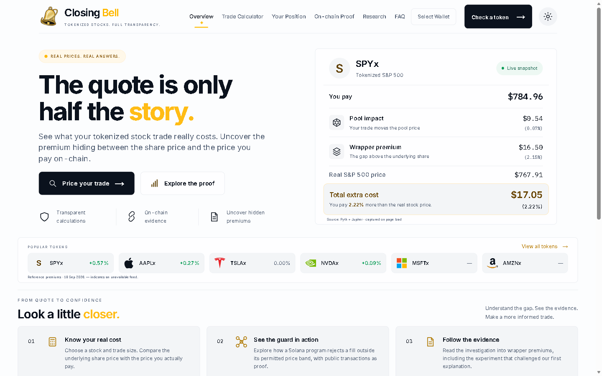
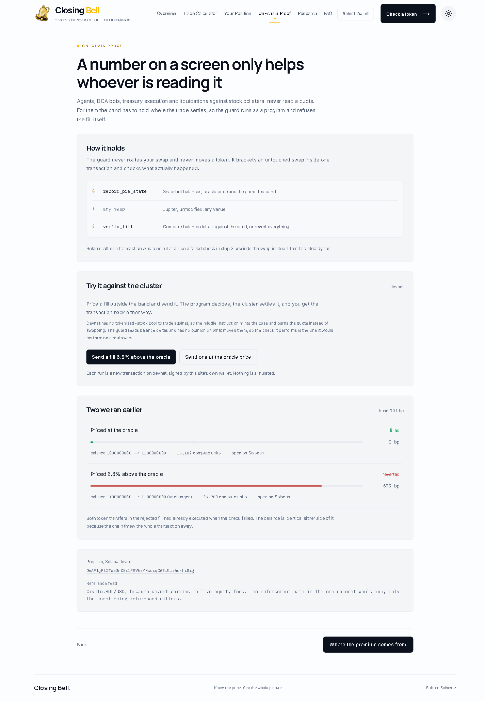

# Closing Bell

[](https://closing-bell-eight.vercel.app/) [](https://www.youtube.com/watch?v=h1NaYHI7oNM) [](https://closing-bell-eight.vercel.app/proof) [](https://closing-bell-eight.vercel.app/api/truecost)

**See the full cost of a tokenized-stock trade, then see how a price guard can reject an expensive fill.** Closing Bell compares a Solana xStock quote with the underlying share's reference price. It separates the cost of moving a liquidity pool from the *wrapper premium* already in that pool's price. A Solana program demonstrates how to enforce a price band when the trade settles.

**[Try the app](https://closing-bell-eight.vercel.app/) · [Watch the demo](https://www.youtube.com/watch?v=h1NaYHI7oNM) · [Inspect the on-chain proof](https://closing-bell-eight.vercel.app/proof) · [Use the public API](#5-use-it-as-an-api)**



*Captured from the [deployed overview](https://closing-bell-eight.vercel.app/) in light mode. Its equity reference was stale when captured; the displayed prices illustrate the UI, not a current market quote.*

---

## The idea in 60 seconds

When you buy a tokenized stock, the swap quote describes execution against its pool. It does
not show how far that pool's price is from the share the token tracks. Closing Bell puts both
numbers side by side.

| What you can do | Why it helps |
|---|---|
| **Check a trade** by ticker and size | See pool impact, wrapper premium, and total cost against the underlying share. |
| **Inspect a position** with a wallet address | Estimate the premium carried by xStocks in a read-only flow. |
| **Explore the guard** | See a devnet fill inside the band succeed and one outside it revert. |
| **Use the API** | Add the cost breakdown to another tool without a wallet or signup. |

The project's September 2026 sample found a $50,000 SPYx buy with **0.06% pool impact** but
**0.58% total cost against SPY**. Those are historical measurements, not today's quote. The
[research section](#4-the-research-we-tried-to-explain-it-and-could-not) explains the method.

---

## 1. The problem: a premium nobody shows

Only authorized participants can redeem wrappers 1:1, so retail traders cannot always
arbitrage a price gap directly. Several measured xStocks traded above their underlying
equity; TSLAx was a useful near-zero control. Pyth publishes a reference ratio, but a
pool-relative swap quote does not show the full gap.

Jupiter measures impact against the pool's *own* mid, so the premium never appears. A
$50,000 SPYx buy shows **+0.06% impact** and costs **+0.58% against SPY** — the invisible
term is roughly ten times the visible one, and unlike impact it is present at every size,
including one share.

Measured 2026-09-18 against mainnet. The pool mid is isolated by quoting both directions at
the same notional, which cancels the spread: `mid = (buy_dev + sell_dev) / 2`.

| ticker | pool mid vs equity | Pyth published ratio | diff | spread |
|---|---|---|---|---|
| SPY | **+60 bp** | +57 bp | +3 | 3 bp |
| TSLA | **+2 bp** | 0 bp | +2 | 10 bp |
| NVDA | +19 bp | +9 bp | +9 | 10 bp |
| AAPL | +35 bp | +27 bp | +9 | 43 bp |
| GOOGL | +7 bp | +19 bp | −12 | 49 bp |

**Correlation 0.931 over n=5.** TSLA's published ratio is 1.00000 and its pool mid is
+2 bp; SPY's is 1.00571 and its mid is +60 bp. A feed-construction artifact would offset
both alike. The premium is in the price people actually trade at.

The roughly $600,000 estimate applies each ticker's mean premium over 1,025 measurements to
circulating supply at the time of analysis, rather than a single probe — after hours, two runs a minute apart have disagreed by
18 bp on TSLA and by $300,000 on the total. It is premium *carried*, not losses taken, and
circulating supply includes the pools' own inventory.

```bash
npx tsx scripts/aggregate-premium.ts
```

---

## 2. Try it in a minute

No wallet or signup is needed to explore. The app uses Jupiter pool quotes and Pyth equity
references, which can become stale. The mainnet band refuses to build a guarded swap if its
equity reference is more than 300 seconds old.

| page | what you'll see |
|---|---|
| [`/`](https://closing-bell-eight.vercel.app) | A live $50,000 SPYx trade split into pool impact and wrapper premium |
| [`/trade`](https://closing-bell-eight.vercel.app/trade) | Any ticker and size, a premium-vs-size sweep, and the mainnet band check |
| [`/position`](https://closing-bell-eight.vercel.app/position) | What a wallet's xStocks are really costing — read-only, never signs |
| [`/proof`](https://closing-bell-eight.vercel.app/proof) | Inspect linked devnet transactions or send a new test fill with the site's wallet |
| [`/findings`](https://closing-bell-eight.vercel.app/findings) | The investigation into *why*, null results included |

Or from a terminal:

```bash
curl "https://closing-bell-eight.vercel.app/api/truecost?ticker=SPYx&notional=10000"
```

---

## 3. Enforce it: the guard program

Showing the number is enough for a human reading a quote. Agents, DCA bots, treasury
execution and liquidations against stock collateral never read one, so the band has to be
enforced where the trade settles.

The guard does not route swaps. An integrator can bracket an existing swap inside one
transaction:

```
ix 0   record_pre_state    snapshot balances + oracle price + band
ix 1   any swap            Jupiter, unmodified, real routing, any venue
ix 2   verify_fill         balance deltas -> realised price -> band check -> revert
```

Atomicity does the enforcement: if verification fails, the whole transaction reverts. The
guard reads balances rather than routing trades or operating its own liquidity pool.

| | |
|---|---|
| Pyth read + band derivation | 3,369 CU |
| Full guarded fill | ~33,000 CU |
| Test suite | 8 cases, all passing |

### Live on devnet — click the rejection

Program [`DeAF1jFtXTweJnC8x1P5VkzYNcdiqC6EfGiz6uxhi8ig`](https://solscan.io/account/DeAF1jFtXTweJnC8x1P5VkzYNcdiqC6EfGiz6uxhi8ig?cluster=devnet)

| | fill | guard | on-chain |
|---|---|---|---|
| at the oracle price | 0 bp | allowed | [tx](https://solscan.io/tx/5KK2pPnAks22g3tPJHYdAhtuhJbwFbk7FKWFVwLiJmGi8VxWwJWSy8fjw23MFWQ3WGp3q3tiA2sQqzyDBndobYy9?cluster=devnet) |
| **6.8% above oracle** | 679 bp | **rejected** | [**tx**](https://solscan.io/tx/2VKxFk8Lnim9pe59pev9NNhyYk3TrRQ7ZyrF5amiCqKR5yUbZ2woLS5KcGXmMrwjqrQxBN44oeGyLAA6e4T9wjS6?cluster=devnet) |



*Captured from the [deployed proof page](https://closing-bell-eight.vercel.app/proof) in light mode. The linked transactions were already on the page; this screenshot did not send a new transaction.*

Devnet has no tokenized-stock pool for this demonstration. Its middle instruction mints the
test base and burns the test quote instead of routing a live xStock swap. The guard checks
the resulting balance deltas, but this is a guard demonstration, not a production trade.

The rejected transaction carries the guard's own reasoning in its logs:

```
fill: BUY base_delta=100000000 quote_delta=119939292
      realised=1199392920000 expected=1123027080300
      deviation=679bps band=301bps
```

`Custom: 6000` is `OutsideBand`. The two token transfers ahead of `verify_fill` had already
executed, and the buyer's balance is **unchanged at 1100000000** — the whole transaction
rolled back. Whole guarded fill costs ~36,800 CU.

The 301 bp band is 200 bp closed-market, plus 1 bp confidence widening, plus 100 bp because
no basis had been pushed for this market — the ageing path widening the band rather than
assuming the centre is exact.

The `/proof` page sends a fresh one of these on every click, signed by the site's own
wallet. Nothing is simulated.

### The same band on mainnet, with nothing deployed

The guard program has not been deployed to mainnet. A second path uses Jupiter's existing
minimum-output check there, subject to a fresh oracle reference.

Every Solana swap already carries an on-chain minimum-output check: Jupiter's `route`
instruction reverts with `SlippageToleranceExceeded` when the fill lands below the
threshold. That threshold is normally derived from **the pool's own mid** — which is exactly
why the premium is invisible: a pool sitting 54 bp rich reports 0 bp of slippage, because
it is measuring against itself.

Derive the threshold from the Pyth oracle instead and the primitive becomes an oracle band.
Nothing of ours runs on-chain; the router enforces our number.

```bash
# example: a SPYx quote outside a 25 bp band is refused
curl "https://closing-bell-eight.vercel.app/api/guarded-swap?ticker=SPYx&notional=10000&band=25"

# example: a TSLAx quote may fit the same band when the reference is fresh
curl "https://closing-bell-eight.vercel.app/api/guarded-swap?ticker=TSLAx&notional=10000&band=25"
```

The control ticker shows up in the product, not just the research: at one moment, at the
same band, SPYx is refused at 49.3 bp and TSLAx goes through at 2.8 bp. Inside the band, the
app simulates the fill against live mainnet and then lets your wallet sign it.

The threshold is checkable rather than claimed. Decoding the built mainnet transaction and
reading the JUP6 route instruction back:

```
we computed   -> slippageBps: 55 | minOutRaw: 2644063800
in the tx     -> slippage_bps: 55 | quoted_out_amount: 2658845336
enforced min  -> 2644221687      | at or above our minimum
```

Rounding always resolves against the trade and never against the user: the demanded amount
rounds up, the tolerance rounds down. A test sweeps prices against bands and asserts that
what Jupiter would enforce never falls below what the band requires.

**Two paths, one band, honestly different in strength.** This path bounds the output amount
and nothing else — it cannot check confidence, the market clock or keeper basis drift, or
verify the realised price from balance deltas after the fill. The guard program does all of
that, and is composable by other programs besides.

---

## 4. The research: we tried to explain it, and could not

### It is a persistent state, not a number

One measurement per ticker cannot separate a structural premium from whatever happened to
be on screen. Sampling every three minutes asks a better question — does each sample
predict the next?

| tkr | premium | persistence (lag-1) |
|---|---|---|
| SPY | 54.9 ± 5.9 bp | **0.929** |
| AAPL | 27.4 ± 11.1 bp | **0.846** |
| NVDA | 12.3 ± 10.5 bp | 0.439 |
| TSLA | −3.5 ± 8.6 bp | **0.034** |

**TSLA is a useful control.** Its measured premium and lag-1 persistence were near zero;
SPY and AAPL had larger premiums and stronger persistence. NVDA's lag-1 figure was lower,
so the pattern is not uniform across the sample.

- **Oracle staleness is not producing it.** Premium against the oracle's own age
  correlates −0.34 to +0.02. A stale-price artifact would be strongly positive.
- **Three samples discarded** by a stated 1% spread rule: one genuine after-hours route
  failure at a 36% implied spread, two merely wide at ~1.2%. The 99th percentile of every
  other sample is 0.80%.

1,025 usable samples over **13.5 hours across five sessions**, as of 2026-09-22 — intraday
only, no overnight or weekend coverage. The sampler appends rather than overwrites, so a
fresh analysis reports a larger set with means that have moved a little — the shape holds,
the last digit does not.

### It tracks dividend yield…

The premium orders by dividend yield and is **exactly zero** for the one ticker in the set
that pays no dividend:

| tkr | AUM $m | liquidity $k | dividend yield | premium |
|---|---|---|---|---|
| SPY | 72.9 | 7,343 | 0.98% | 57.1 bp |
| QQQ | 60.8 | 1,808 | 0.40% | 27.3 bp |
| AAPL | 51.9 | 656 | 0.32% | 26.6 bp |
| GOOGL | 56.5 | 457 | 0.23% | 19.3 bp |
| NVDA | 70.6 | 2,065 | 0.46% | **9.2 bp** |
| TSLA | **83.6** | 1,345 | 0.00% | **0.0 bp** |

Correlation with dividend yield is **0.887**, against **−0.235** for AUM and 0.780 for
liquidity. Size and demand are ruled out by TSLA: the largest wrapper in the set by AUM,
with healthy liquidity, carries a premium of exactly zero.

### …but the dividend story does not close

- **SPY's ex-dividend date fell inside the build window.** A ~$1.90 dividend on a $759
  spot predicts a **~25 bp step** at the open. Measured across the open: **−5.4 bp.**
  SPY's spread is 3 bp, so a 25 bp step would have been unmissable. **No step.**
- **NVDA yields 0.46%**, more than AAPL or GOOGL, yet carries the smallest premium of the
  three. That inversion is unexplained.
- The implied accrual window clusters at **7–10 months** against a wrapper that launched
  roughly 14 months ago.

**The mechanism is unresolved.** The product can show the measured price gap without
depending on one explanation for it.

```bash
npx tsx replay/pool-vs-equity.ts       # the basis measurement
npx tsx scripts/analyze-basis.ts       # persistence, dispersion, staleness confound
```

---

## 5. Use it as an API

The public API exposes the cost breakdown without a key or signup. Its GET endpoints are
read-only. The POST routes build an unsigned mainnet transaction or send a devnet test
transaction, so inspect their behavior before integrating them.

```bash
curl "https://closing-bell-eight.vercel.app/api/truecost?ticker=SPYx&notional=10000"
```

```jsonc
{
  "oracle":    { "price": 773.56, "ageSecs": 13, "feed": "Equity.US.SPY/USD", "shard": 1 },
  "pool":      { "midPrice": 777.75, "fillPrice": 777.86, "venues": ["Raydium CLMM", "Byreal"] },
  "breakdown": {
    "poolImpactBps":     1.4,   // what your aggregator shows you
    "wrapperPremiumBps": 54.3,  // what nothing shows you
    "trueCostBps":       55.7
  }
}
```

| endpoint | method | params | returns |
|---|---|---|---|
| `/api/truecost` | GET | `ticker` (SPYx/AAPLx/TSLAx/NVDAx), `notional` (100–10,000,000 USD) | pool impact vs wrapper premium for that size |
| `/api/position` | GET | `address` (any Solana pubkey) | premium carried by that wallet's xStock holdings |
| `/api/guarded-swap` | GET | `ticker`, `notional`, `band` (0–1000 bps) | the oracle band, and whether a fill fits inside it |
| `/api/guarded-swap` | POST | same, plus `userPublicKey` in the body | an unsigned mainnet transaction carrying the band, or a refusal |
| `/api/guard/run` | POST | `mode` (`reject`/`allow`) | sends a devnet test fill, returns the signature |

`400` means the request was wrong and retrying will not help; `502` means a feed or route
could not be reached and retrying might. Responses carry a 15-second shared cache, well
inside the premium's own rate of change.

**If you are also building for Stocklana, take the number.** It costs one `curl`, and a
second independent implementation of this measurement is worth more to the finding than
exclusivity is worth to us.

### The dataset

`replay/basis-dense.jsonl` — every sample the basis sampler has taken, one JSON object per
line, at a three-minute cadence across four tickers:

```jsonc
{"t":1789776953,"sym":"NVDA","oracle":222.515,"oracleAge":955,
 "buyBps":18.17,"sellBps":11.49,"midBps":14.83,"spreadBps":6.66}
```

As far as we can tell, a public time series of the tokenized-equity basis at this cadence
does not exist anywhere else. It is committed rather than summarised because the mechanism
is still unexplained, and the honest thing to publish alongside an open question is the
data that raised it. Error rows and wide-spread rows are kept, so anyone re-analysing it
can choose their own exclusion rule.

```bash
npx tsx scripts/build-series-json.ts    # regenerate the chart on /findings
keeper/run-sampler.cmd                  # keep sampling
```

---

## 6. Run it yourself

### The app

```bash
cd app && cp .env.example .env.local   # fill in an RPC URL at minimum
npm install && npm run dev
```

### The program tests

Eight cases, all passing from a clean clone. It takes three terminals' worth of setup, so
the exact commands are here rather than an `anchor test` that does not work on its own.

```bash
anchor build
anchor keys sync          # a clean clone generates its own program keypair
anchor build              # declare_id! changed, so build again

# terminal 2 — the mainnet Pyth account has to be cloned in
solana-test-validator --reset --url https://api.mainnet-beta.solana.com \
  --clone D9uk39pqZMcnmtPP9WeC8cREUpKZmyXLga9mSQ79SphW \
  --clone XsbEhLAtcf6HdfpFZ5xEMdqW8nfAvcsP5bdudRLJzJp

# back in terminal 1
solana airdrop 100 --url http://127.0.0.1:8899
export PROGRAM_ID=$(solana address -k target/deploy/closing_bell_guard-keypair.json)
anchor test --skip-local-validator
```

Two things will bite otherwise: `anchor test` on its own tries to spawn `surfpool` and dies
if it is not installed (hence the hand-started validator and `--skip-local-validator`), and
`PROGRAM_ID` must be exported or the test falls back to the devnet address.

**Cases:** fill at oracle (allowed) · 6.8% above (reverts, balances roll back) · 1.5% above
(allowed inside band) · sell 6.8% below (reverts — the band is symmetric) · snapshot with no
swap (`NoFillDetected`, not a divide-by-zero) · keeper basis above the ceiling
(`BasisOutOfBounds`) · `verify_fill` pointed at a substituted token account
(`TokenAccountMismatch`) · `cancel_pending` reclaiming a stray snapshot.

An allowed fill has measured between 30,300 and 34,900 CU across runs; the arithmetic
depends on the live oracle price, so the figure moves a little each time.

---

## 7. Honest limits

- **Deployed to devnet, not mainnet.** The mainnet-fork setup is
  committed: `scripts/fork-mainnet.sh` boots a local validator forked from mainnet carrying
  the **real Raydium CLMM pool SPYx trades in**, the real Pyth SPY feed and the real
  Token-2022 mint. The account set is derived, not hand-written —
  `scripts/derive-clone-set.ts` asks Jupiter to build a real swap and reads back every
  account it touches.
- **The basis is keeper-supplied**, because the source feeds are not maintained on-chain
  (`Crypto.*X/USD` was 5.8 days stale and `Crypto.*X/*.RR` ~59 days stale, shard 0 only).
  It is bounded in-program rather than trusted — a 300 bp ceiling against measured values of
  57 bp and 27 bp, a 10 bp/min drift limit, and ageing out after an hour with the band
  widened rather than the centre silently assumed exact.
- **The mainnet band refuses stale references.** A guarded swap needs an equity price no
  older than 300 seconds, and refuses to build otherwise. When the Pyth equity feed goes
  quiet, the live numbers drift and every guarded quote is refused — the app shows the
  oracle's age on every page so this is visible rather than silent.
- **Devnet has no live equity feed** (`Equity.US.AAPL/USD` was 78 days stale there), so the
  devnet demo bands against `Crypto.SOL/USD`. The mechanism is identical; only the
  reference asset differs. Devnet's fresh shard is 0, the inverse of mainnet.
- **Devnet test mints** reproduce the xStock extensions that matter — permanent delegate and
  freeze authority. The transfer hook is omitted because on mainnet every xStock carries it
  *disabled*.
- **The off-hours thesis did not survive measurement.** No off-hours penalty was found;
  several names are worse mid-session. The dislocation at size is a thin-AMM property that
  holds around the clock. See `docs/day0-findings.md` section 12.
- **The guard binds only transactions that include its two instructions.** For your own
  users that holds by construction; for others it is an instruction they append, not
  protection for a pool as a whole.

---

## 8. What happens after the hackathon

The guard is a primitive, not an app — the seatbelt, not the car.

**Who needs it first:**

- **Liquidation engines holding tokenized stock as collateral.** A liquidation priced
  against the pool rather than the equity mis-marks by the premium. At SPYx's measured
  58 bp that is **~$580 per $100,000 liquidated**, against the borrower, every time,
  silently.
- **DCA and treasury bots.** They never read a quote, so a UI warning cannot reach them —
  and buying weekly at a premium averaging 51 bp is a standing cost nothing on their
  dashboard reports.
- **Anything routing size.** The premium does not shrink with better execution, because it
  is not execution — it is present at one share and at ten thousand.

**What ships next, in order:**

1. **Mainnet deploy** and switch the reference to the `Equity.US.*` feeds. No
   program logic changes; the mainnet fork already exercises this path.
2. **Retire the keeper-supplied basis.** Pyth's `Crypto.*X/*.RR` feeds would close it
   outright if maintained on mainnet at a fresh shard — the one dependency outside our
   control.
3. **One integration.** A primitive with zero integrations is a demo. The honest next step
   is a single lending protocol or execution bot wiring `record_pre_state` / `verify_fill`
   around its existing swap — no change to how they route.

**What would tell us to stop:** if the premium converges as redemption opens to more
participants, the band stops binding and the guard becomes dead weight. That is a real
possibility, and the measurement infrastructure would be the thing that told us.

---

## 9. How we kept the evidence honest

Two independent bugs in this build had the same shape — the thing being tested worked, and
the *proof* of it was what failed.

1. **The test suite asserted on error message strings.** `skipPreflight` suppresses logs on
   the thrown error, so those assertions would have passed on *any* failure, including the
   wrong one. Now asserts on Anchor error codes.
2. **The first devnet run lost the rejected transaction's signature.**
   `sendAndConfirmTransaction` throws on a rejected fill, and the signature was scraped from
   the error text by a regex that did not match. The guard blocked the fill exactly as
   intended and the artifact proving it was thrown away. Now sends via `sendRawTransaction`
   so the signature is in hand before confirmation reports failure.

Both were caught by checking the evidence rather than the outcome. The same habit caught two
bad numbers in the analysis: an estimated NVDA dividend yield that reversed a conclusion
once verified, and a fabricated Pyth feed id that silently corrupted a correlation to
−0.016. Figures that drive a conclusion were checked against their source; estimates are
labelled.

Full measured record, including where evidence contradicted the original design:
[docs/day0-findings.md](docs/day0-findings.md).

---

## Repository layout

```
programs/closing-bell-guard/     Anchor program: config, market, clock, record/verify
app/                             Next.js true-cost frontend + public API
scripts/deploy-devnet.ts         Devnet setup + the blocked-fill transaction
scripts/fork-mainnet.sh          Local validator forked from mainnet with the real SPYx pool
tests/guarded-fill.ts            Eight enforcement cases
replay/pool-vs-equity.ts         The basis measurement
replay/depth-at-size.ts          Depth across notional tiers and thin names
replay/basis-dense.jsonl         The full three-minute basis dataset
keeper/sample-feed-freshness.ts  Is the Pyth push path needed at all?
```

Built with Anchor 1.2.0, solana-cli 4.1.2, pyth-solana-receiver-sdk 2.0.0, under WSL2.
Anchor 0.31.1 cannot build this — see the toolchain notes in the findings doc.
